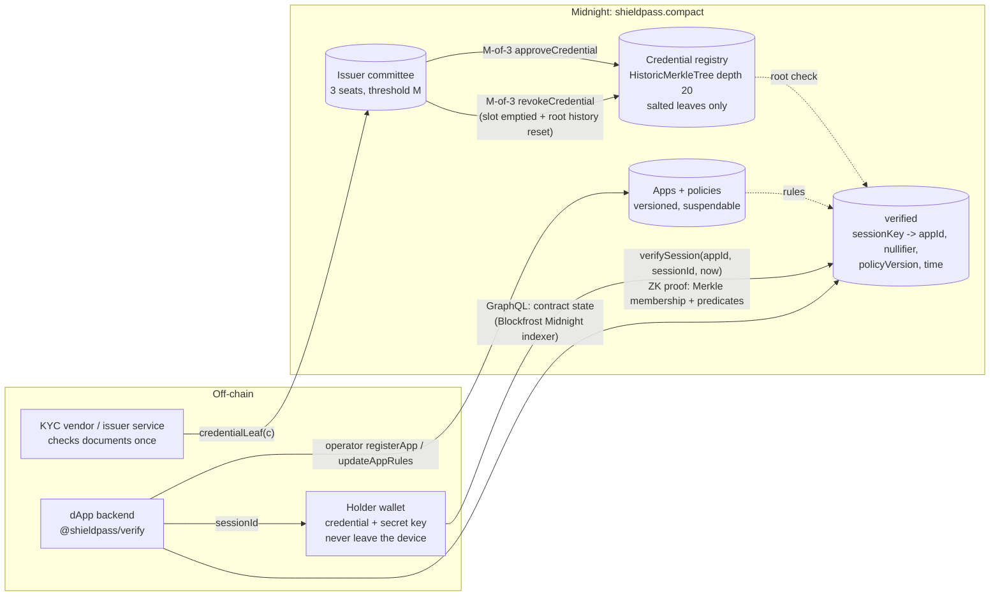
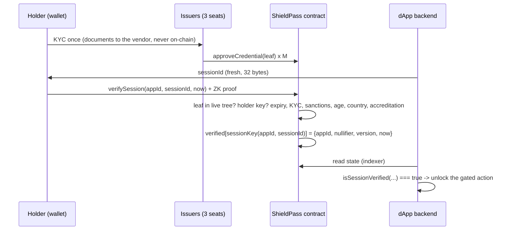

# ShieldPass

**A zero-knowledge compliance gate for Midnight dApps.** A user proves "I'm KYC'd, sanctions-clear, not in a blocked country, at least 18 (and, if you need it, accredited)" and your dApp learns one thing: **session `S` passed your policy.** No name, no passport scan, no birthday, no country, no wallet history. Nothing a regulator would call personal data ever reaches your servers or the chain.

> Status: **testnet MVP, not audited.** The Compact contract compiles with `compactc 0.31.1` (full ZK build, 6 circuits). 15 contract simulation tests and 7 SDK tests pass, and every circuit proves locally against proof server 8.1.0 (`verifySession` in about 3 s, see [docs/local-proofs.json](docs/local-proofs.json)). It is **deployed on Midnight Preprod** (`797d3066…`) and a live drill passed: 2-of-3 issuance, a `verifySession` proof, and `@shieldpass/verify` returning true/false (see [Deployment](#deployment)).

## Why

Every DeFi, RWA and gaming app on Midnight will hit the same wall: regulators and partners want KYC / sanctions / geo / age checks, users don't want to hand their documents to every app, and apps don't want to store them (breach liability, GDPR, cost). Today each app integrates a KYC vendor itself and ends up holding a honeypot of PII.

ShieldPass splits the job:

- **Issuers** (licensed KYC vendors) check a person once and attest a credential. Each credential needs approval from **2 of 3 issuer keys**, so no single issuer key can mint credentials.
- **Holders** keep the credential on their device and prove predicates about it in zero knowledge, once per app session.
- **dApps** register a policy (min KYC level, sanctions, blocked countries, min age, accreditation) and check a session with one call: `isSessionVerified({ contractAddress, appId, sessionId })`.

## How it works





### Contract (`contracts/src/shieldpass.compact`)

| Circuit | Who | What |
| --- | --- | --- |
| `constructor(committee, m)` | deployer = operator | Three distinct, non-empty issuer seat commitments, threshold `m` in 1..3 (same validation as PlutusShield's v2 claims committee). |
| `approveCredential(leaf)` | issuer seat | One vote per seat per leaf. The M-th approval appends the leaf to the registry tree and marks it `ACTIVE`; before that it is `PENDING` and unprovable. Revoked or issued leaves can't be re-approved. |
| `revokeCredential(leaf)` | issuer seat | One vote per seat. The M-th vote empties the leaf's slot (`insertIndexDefault`) and calls `resetHistory()`, so no proof against any older root still verifies. |
| `verifySession(appId, sessionId, now)` | holder | Proves: the caller knows the secret behind the credential's holder commitment; the credential's leaf is in the tree (Merkle path vs. a valid root); not expired; KYC level, sanctions, accreditation, minimum age and country-not-blocked per the app's rules; `now` is within ±900 s of block time. Writes one `SessionRecord` under `sessionKey(appId, sessionId)`; a key verifies only once. |
| `registerApp / updateAppRules / setAppActive` | operator | Register a paying dApp, change its rules (version bump; old sessions keep their version), suspend it (unpaid invoice) or reinstate it. |

Hashes (all mirrored by the SDK, all plain SHA-256 over 32-byte words in compact-runtime 0.16):

```
roleCommitment(sk, tag) = H(pad32("shieldpass:role:") || tag || sk)
credentialLeaf(c)       = H(pad32("shieldpass:credential:v1") || persistentHash<Credential>(c))
sessionKey(app, sid)    = H(pad32("shieldpass:session:v1") || app || sid)
appNullifier(app, sk)   = H(pad32("shieldpass:nullifier:v1") || app || sk)
```

`Credential = { holder, country (ISO 3166-1 numeric), birthDate (s since 1900-01-01), kycLevel, sanctionsClear, accredited, expiry (unix s), salt }`.

### SDK (`packages/verify`, `@shieldpass/verify`)

```ts
import { isSessionVerified, newSessionId } from "@shieldpass/verify";

const sessionId = newSessionId();               // give this to the user's wallet
// ... user proves with their wallet ...
const ok = await isSessionVerified({
  contractAddress: SHIELDPASS_ADDRESS,
  appId: MY_APP_ID,
  sessionId,
  minPolicyVersion: 2,     // optional: only sessions proved under your current rules
  maxAgeSeconds: 600,      // optional: only recent proofs
});
```

- No WASM, no wallet, no keys: one GraphQL POST for the contract's latest state, then a small decoder (tested against the compiled contract's `ledger()`; pass `decodeLedger` to use that instead).
- Checks the record's `appId` (a session verified for app A is never `true` for app B), plus optional policy version and age. Indexer or config errors **throw**: it fails closed, never a silent `true`.
- `checkSession(...)` returns the record (including the per-app nullifier, for "one account per person") and the reason for a `false`.
- **Indexer.** Midnight retired `indexer.preprod.midnight.network` on 2026-10-09 (HTTP 410). The default is Blockfrost's Midnight indexer: set `BLOCKFROST_MIDNIGHT_PREPROD_ID` (a `nightpreprod…` project id) or `MIDNIGHT_PREPROD_INDEXER_URL` for your own indexer; mainnet uses `BLOCKFROST_MIDNIGHT_MAINNET_ID` / `MIDNIGHT_MAINNET_INDEXER_URL`, or pass `indexer: { url, projectId }`. Project ids are sent as the `project_id` header/query and never appear in error messages. There is no keyless default.

## Threat model

| Threat | Mitigation | Residual risk |
| --- | --- | --- |
| A single issuer key is stolen or goes rogue and mints credentials | Issuance needs M-of-3 seat approvals (one vote per seat per leaf). | M colluding/compromised seats can mint. Seats should be run by different operators. In this MVP all three seats are team-run. |
| Someone fakes attributes (country, age) | The proof must open a leaf that M issuers approved; changing any attribute changes the leaf, so the Merkle check fails. | Issuers must check the documents properly. ShieldPass attests that issuers signed, not that they were honest. |
| A stolen or borrowed credential | The holder must know the secret behind `credential.holder`; issuers only ever see the commitment. | A holder can share their secret or prove on behalf of someone else ("proof lending"). The per-app nullifier limits this to one pseudonymous account per person per app if the dApp enforces it. |
| Revoked credential keeps working | Revocation empties the slot and resets root history, so old roots stop verifying; tests cover a holder replaying a cached pre-revocation path. | Revocation needs M votes on-chain; a proof that lands before the M-th vote still counts. |
| Replay / cross-app reuse | Session keys verify once; the key is bound to the appId; the SDK checks the record's appId; the proof is bound to `(appId, sessionId, now)`. | The dApp must issue unpredictable session ids and tie them to the user's session or wallet off-chain. |
| Linking a user across dApps | The nullifier is `H(appId, holderSecret)`: stable inside one app, unrelated across apps. The proof hides which leaf was used (anonymity set = all live credentials). | Within one app, sessions from the same holder are linkable on purpose. A tiny registry gives a small anonymity set. Timing and network metadata are out of scope. |
| Back-dating to dodge expiry or age checks | `now` must be within ±900 s of block time. | Age uses a 365.2425-day year, so it can be off by up to about a day around a birthday. |
| Ledger leaks attributes | Only salted leaves, approval counts and statuses are public. Each assert discloses one always-true bit. | Issuers see the leaf at approval, so an issuer can tell that a person holds some credential. They can't see which app the person uses or when. |
| Operator abuse | The operator can only register, update or suspend apps (billing). It can't issue, revoke or verify. | The operator can suspend an app or change its rules, and every change is public and versioned. |
| SDK false positive | The decoder requires the exact sessionKey cell followed by the 4-field SessionRecord header, then checks appId. Only `verifySession` writes that map. | String decoding depends on the 0.31.1/runtime 0.16 state encoding. Pin versions, or pass `decodeLedger`. |

Not audited. Don't put real PII or mainnet funds behind it yet.

## Pricing idea (B2B)

ShieldPass charges dApps, never users:

- **Platform fee** per app per month (e.g. $299 Starter / $999 Growth / custom Enterprise) covering registration, policy updates and the integration dashboard.
- **Per verified wallet**: a small charge per unique per-app nullifier per month (e.g. $0.10 to $0.50, tiered), paid in **USDC / USDM**. The nullifier gives a privacy-preserving way to count unique users without knowing who they are.
- **Users pay nothing.** The operator sponsors `verifySession` fees with **DUST** from its own NIGHT holdings, so users don't need NIGHT or DUST to prove.
- Issuers (KYC vendors) get a revenue share per credential issued. The operator's `setAppActive` enforces billing on-chain.

## Roadmap

1. **Issuer service** with a KYC vendor sandbox (e.g. a vendor's test environment). It runs the document check, builds the credential, hands it to the holder's wallet, and coordinates M-of-3 seat approvals with seats run by different operators.
2. **Browser proving with Lace**: the holder proves `verifySession` from the Lace Midnight wallet with a one-click "Verify with ShieldPass" button.
3. **DUST sponsorship**: the operator pays proof fees so users need no tokens.
4. **Integration dashboard** for apps: register, set rules, rotate versions, see verified-wallet counts and invoices, suspension status.
5. **Gated-swap demo**: a sample DEX swap that only opens when `isSessionVerified` is true, end to end on Preprod.
6. Later: credential re-issuance and expiry renewal, issuer seat rotation, per-app policy hashes for richer predicates, mainnet on Blockfrost Midnight, and an audit.

## Repository layout

```
contracts/src/shieldpass.compact   Compact contract (compactc 0.31.1)
contracts/test/                    simulation tests (compiled Contract + compact-runtime 0.16.0)
packages/verify/                   @shieldpass/verify SDK + tests
contracts/preprod/                 Preprod deploy + live drill runner (shared wallet lock, Blockfrost)
deployments/                       public deployment records (no keys)
```

## Build and test

Requirements: Node 22.18+, pnpm 9, the `compact` tool with compiler **0.31.1** (`compact update 0.31.1`; 0.35 output does not run on the current networks).

```bash
pnpm install
pnpm test            # --skip-zk compile, 15 contract tests, then 7 SDK tests
pnpm compile         # full ZK build (prover/verifier keys + zkir for 6 circuits, ~20 s)
pnpm --filter @shieldpass/contracts prove:local   # prove every circuit against a proof server on :6300 (no wallet, no submit)
```

Start a proof server with `podman run -d -p 6300:6300 docker.io/midnightntwrk/proof-server:8.1.0 midnight-proof-server -v`. Last local run (2026-10-11): registerApp 0.9 s, approveCredential 1.0 to 1.5 s, **verifySession 3.0 s**, revokeCredential 1.0 to 1.4 s, setAppActive 0.8 s. Each proof is 4,508 bytes.

## Deployment

**Midnight Preprod: deployed, live drill passed (2026-10-11).** Record: [deployments/preprod.json](deployments/preprod.json).

- Contract: `797d3066eb9e2e36762b9cd7751ea845e4f9bafe5b62b701b58bac3711ca78c9` ([explorer](https://preprod.midnightexplorer.com/contracts/0x797d3066eb9e2e36762b9cd7751ea845e4f9bafe5b62b701b58bac3711ca78c9)), 2-of-3 issuer committee, compactc 0.31.1.
- Drill, all `SucceedEntirely` on Preprod:

| Step | Tx hash | Block |
| --- | --- | --- |
| deploy (operator, committee of 3, threshold 2) | [`d020ea5c…3f4c54`](https://preprod.midnightexplorer.com/transactions/0xd020ea5c56467a13e9d8c18c3bde72b0ed9904cd78a6d25fc00798e1693f4c54) | 2939847 |
| `registerApp` (demo app, KYC ≥ 1, sanctions-clear, 18+, blocks 408/364/192) | [`6ca546f4…dcc25f`](https://preprod.midnightexplorer.com/transactions/0x6ca546f4e19a14ccf86612b7fde7f7a997b9327109c740260bb584802bdcc25f) | 2939854 |
| `approveCredential` seat 0 (PENDING) | [`9688d199…cf1058`](https://preprod.midnightexplorer.com/transactions/0x9688d199e069bc8c96bbf672c14eb4c38726c7692392ddf07159e64720cf1058) | 2939861 |
| `approveCredential` seat 2 (2 of 3: ACTIVE, in the registry) | [`43e5d631…0286af`](https://preprod.midnightexplorer.com/transactions/0x43e5d631b510e57cd379afb3930edb62c91c0be06410467a31f54381070286af) | 2939865 |
| `verifySession` (holder ZK proof) | [`ac529109…175b7f`](https://preprod.midnightexplorer.com/transactions/0xac5291093d9e0cb194ad6841ffad4616363829e9aec5e987bb673f1650175b7f) | 2939869 |

- `@shieldpass/verify` against the Blockfrost Midnight Preprod indexer: `isSessionVerified` is **true** for the drill session (`c696ff64…`), **false** for an unknown session id and **false** for a different app id; its no-WASM decoder returns the same nullifier as the compiled contract's `ledger()`.
- The demo credential is for a fake person; only its salted leaf is on-chain. All three issuer seats and the operator are team-held testnet keys (kept outside the repo).

**Endpoints.** Midnight shut down its hosted Preprod indexer and RPC on 2026-10-09. Preprod now goes through Blockfrost, with a Midnight Preprod project id (`nightpreprod…`) appended as `?project_id=`:

| Service | URL |
| --- | --- |
| Indexer GraphQL | `https://midnight-preprod.blockfrost.io/api/v0` |
| Indexer WebSocket (`graphql-transport-ws`) | `wss://midnight-preprod.blockfrost.io/api/v0/ws` |
| Node RPC | `https://rpc.midnight-preprod.blockfrost.io` / `wss://rpc.midnight-preprod.blockfrost.io` |
| Proof server | local `http://127.0.0.1:6300` (`midnightntwrk/proof-server:8.1.0`) |

**Re-running.** `contracts/preprod/run-preprod.sh [--dry-run]` runs `contracts/preprod/shieldpass-preprod.mjs` from the midnight-js workspace, holds the shared Preprod wallet lock (the wallet PlutusShield's relay uses), reads `BLOCKFROST_MIDNIGHT_PREPROD_ID` from the secrets env and redacts project ids from all output. Every step re-reads the ledger and is skipped if it already landed, so a rerun resumes instead of duplicating txs. Run `pnpm compile` (full ZK build) first. A cold wallet sync takes about 45 minutes on Preprod.

## Midnight Buildathon notes

- **Track:** Midnight Buildathon on AKINDO, **Wave 3** (build Oct 27 to Nov 16, 2026).
- **Compact contract that compiles:** `contracts/src/shieldpass.compact`, full ZK compile with `compactc 0.31.1`.
- **Meaningful Midnight functionality:** private credential registry, ZK membership + predicate proofs, per-app nullifiers, M-of-3 issuer governance, on-chain revocation via root-history reset.
- **License:** Apache-2.0 for all code in this repo (`LICENSE`).
- **GitHub label:** topic `midnightntwrk` is set (plus `midnight`, `zk`, `compliance`, `privacy`).
- **Not a fork:** ShieldPass is a new contract. It reuses *patterns* from [PlutusShield](https://github.com/Kshot3000/PlutusShield) (witness-commitment roles, the M-of-3 committee and its validation, the no-WASM indexer reader, the Preprod deploy flow) by the same team, and it is a different product.
- **Wave progress:** this repo started on 2026-10-11, **before** the Wave 3 build window. The Wave 3 submission's progress description should cover only what is built from Oct 27 on (roadmap items 1 to 5). The commit history is the baseline.
- **Still needed for submission:** slide deck, demo video, README "how judges can test" walkthrough on Preprod.

## License

Apache License 2.0. See [LICENSE](LICENSE).
